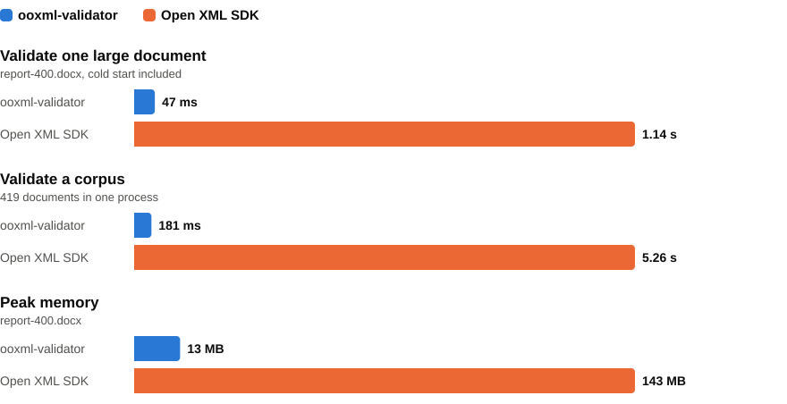

<h1 align="center">ooxml-validator</h1>
<p align="center">Microsoft's Open XML SDK validator for Word documents, rewritten in Rust: the same verdicts, [[X]]× faster, no .NET.</p>
<p align="center">
  <a href="#use-it">Get started</a> ·
  <a href="#how-it-agrees">How it agrees</a> ·
  <a href="#how-fast">Benchmarks</a> ·
  <a href="DESIGN.md">How it works</a>
</p>

![The Open XML SDK and ooxml-validator each checking a 400-page report and then a broken file: the same verdicts, the SDK in [[SDK_S]], ooxml-validator in [[OURS_MS]]](docs/demo.gif)

*A real terminal session: the SDK runs through the small C# program in `fuzz/oracle`, then
`ooxml-validator` runs on the same files.*

## Use it

```sh
npm install @2018kguo/ooxml-validator      # WebAssembly, any OS, Node 20+
cargo install ooxml-validator              # a native binary
```

```sh
$ ooxml-validator report.docx broken.docx
report.docx: ok
broken.docx: 2 errors
  /word/document.xml w:rPr Sch_UnexpectedElementContentExpectingComplex: The element 'w:rPr' has an out-of-place child element (Sch_UnexpectedElementContentExpectingComplex).
  /word/styles.xml w:shd Sch_MissRequiredAttribute: The required attribute 'val' is missing.
```

It exits 1 when any file is invalid. `--json` prints one object per file with every error's id,
description, part and element, and `--max-errors N` caps the list (default 1000, as the SDK does).

From JavaScript:

```js
import { readFile } from "node:fs/promises";
import { validate } from "@2018kguo/ooxml-validator";

const report = await validate(await readFile("report.docx"));
// { ok: false, openError: null, errors: [{ id, description, part, node, errorType }, ...] }
```

`validate` runs on the thread that calls it. A server should keep that off its event loop:

```js
import { createValidatorPool } from "@2018kguo/ooxml-validator/worker";

using pool = createValidatorPool({ threads: 2 });
const report = await pool.validate(bytes, { maxErrors: 50 });
```

From Rust:

```rust
let report = ooxml_validator::check(&std::fs::read("report.docx")?);
for e in &report.errors {
    println!("{} {} {}: {}", e.part, e.node, e.id, e.description);
}
```

## What it checks

Everything `OpenXmlValidator(FileFormatVersions.Microsoft365)` checks in a .docx, with the SDK's
error ids:

- **The schema:** child order and counts, required and undeclared attributes, every simple type as
  .NET parses it (`Int32`, on/off, hex, unions, patterns, lengths), version-gated elements and
  enum values.
- **Markup compatibility:** `mc:Ignorable`, `mc:ProcessContent`, `mc:AlternateContent`.
- **Semantic constraints:** unique ids, value ranges, attributes that require or exclude each
  other, relationship ids and types, references into other parts.
- **The package:** required, allowed and repeated parts, and everything that keeps the SDK from
  opening a file at all: XML that isn't well formed, a missing part, a wrong content type, a bad
  relationship, an encoding .NET doesn't read.
- **Strict documents (ISO 29500):** read as Transitional, as the SDK reads them.

Descriptions are its own, shorter than the SDK's, and an error names its element rather than an
XPath.

## How fast

<picture>
  <source media="(prefers-color-scheme: dark)" srcset="docs/benchmarks-dark.svg">
  
</picture>

[[BENCH_TEXT]]

The SDK side is published ReadyToRun, its fastest setup. To rerun it:

```sh
python3 bench/generate.py report.docx 400
python3 bench/compare.py --sdk "dotnet fuzz/oracle/bin/out/Oracle.dll" \
  --ours target/release/ooxml-validator --wasm "node npm/cli.js" \
  --large report.docx --corpus list-of-docx-paths.txt
```

The SDK builds a DOM of the whole document and, for each value that fails a union member, a
localized error message it then discards. ooxml-validator reads each part once as a stream of
borrowed bytes, with names and namespaces turned into integers when they are declared, and checks
parts on several threads. [DESIGN.md](DESIGN.md#speed) has the changes that mattered.

## How it agrees

The SDK is the reference, quirks included, and the tests check against the SDK itself:

- `gen/` turns the SDK's own schema data, part definitions and constraint registrations into
  static tables, and stops if the SDK adds something it doesn't know how to port.
- `fuzz/oracle` is a 60-line C# program around the SDK. `fuzz/diff.py` runs both on a list of files
  and fails on any document where the verdict or the set of error ids differs.
- `fuzz/agree.sh` checks the SDK's own test documents, 600 mutants of them, 97 documents with the
  problems real producers write (LibreOffice, JavaScript and PDF converters) and a generated
  report. CI runs it on every push.
- Every week CI fuzzes with a new seed and tries the newest SDK release on NuGet. A release that
  agrees becomes a pull request, one that doesn't becomes an issue.
- Before release it also agreed with the SDK on [[N_DOCS]] documents in all: those, plus more than
  7,000 real-world files and their mutants.

## Limits

- Word documents only (.docx, .docm, .dotx). Not Excel or PowerPoint.
- The Microsoft365 file format only, the newest the SDK knows.
- Error descriptions and order differ from the SDK's; the set of error ids doesn't.
- Pinned to SDK [[SDK_VERSION]] until the weekly job proposes a newer one.

## License

MIT. The schema tables are generated from the [Open XML SDK](https://github.com/dotnet/Open-XML-SDK)'s
data, MIT-licensed by the .NET Foundation; [NOTICE](NOTICE) has its license.
